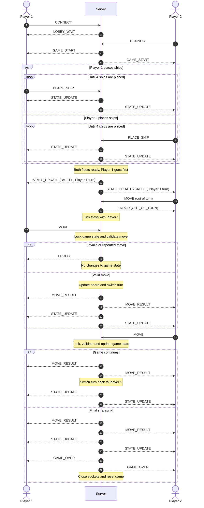

# Sprint 2: Sequence Diagram

**Architecture:** Multi-threading with `threading.Lock`

## 1. Mermaid Sequence Diagram

The diagram shows how both players communicate with the server, from connecting and placing ships to taking turns and finishing the game.

## 2. State and Score Synchronization

The server controls the game state and uses `threading.Lock` when checking moves or updating shared information. This prevents both player threads from changing the game at the same time.

- **Valid moves:** The server updates the board, sends `MOVE_RESULT`, and broadcasts `STATE_UPDATE` to both players.
- **Invalid moves:** The server sends `ERROR` without changing the turn, board, or score.
- **State updates:** Each player receives their own board and known opponent hits and misses without revealing hidden ships.
- **Scores:** Players earn one point for each enemy ship sunk. Scores are calculated from the remaining ship counts in `STATE_UPDATE`.
- **Game over:** The server sends `GAME_OVER`, closes both game connections, and resets for the next game.

Messages are placed in each client's outgoing queue while the game state is locked. The sender threads then deliver them in order without holding the lock.

If a player disconnects during the game, the remaining player wins by forfeit. If a third client connects while the game is full, the server rejects the connection.
